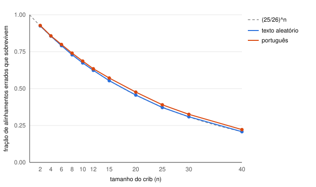

# Resultados dos experimentos (semente 2026)

## E1 – Nenhuma letra é cifrada nela mesma

Letras cifradas: 1.000.000. Coincidências claro=cifrado: **0** (uma cifra ideal teria ≈ 38.462).

## E2 – Fração de alinhamentos errados que sobrevivem

| fonte | n | sobrevivencia_media | desvio | teorico | candidatos_esperados_msg250 | correto_sobreviveu |
|---|---|---|---|---|---|---|
| aleatorio | 2 | 0.9244 | 0.0165 | 0.9246 | 229.3 | 300/300 |
| aleatorio | 4 | 0.8556 | 0.023 | 0.8548 | 210.3 | 300/300 |
| aleatorio | 6 | 0.7909 | 0.0251 | 0.7903 | 192.8 | 300/300 |
| aleatorio | 8 | 0.7288 | 0.027 | 0.7307 | 176.8 | 300/300 |
| aleatorio | 10 | 0.6737 | 0.0299 | 0.6756 | 162.1 | 300/300 |
| aleatorio | 12 | 0.6236 | 0.0321 | 0.6246 | 148.7 | 300/300 |
| aleatorio | 15 | 0.5534 | 0.0318 | 0.5553 | 130.5 | 300/300 |
| aleatorio | 20 | 0.4561 | 0.0307 | 0.4564 | 105.0 | 300/300 |
| aleatorio | 25 | 0.3717 | 0.0325 | 0.3751 | 84.4 | 300/300 |
| aleatorio | 30 | 0.3091 | 0.0308 | 0.3083 | 67.8 | 300/300 |
| aleatorio | 40 | 0.2079 | 0.028 | 0.2083 | 43.7 | 300/300 |
| portugues | 2 | 0.9274 | 0.016 | 0.9246 | 229.3 | 300/300 |
| portugues | 4 | 0.8573 | 0.0212 | 0.8548 | 210.3 | 300/300 |
| portugues | 6 | 0.7987 | 0.0275 | 0.7903 | 192.8 | 300/300 |
| portugues | 8 | 0.7401 | 0.0297 | 0.7307 | 176.8 | 300/300 |
| portugues | 10 | 0.6862 | 0.0313 | 0.6756 | 162.1 | 300/300 |
| portugues | 12 | 0.6342 | 0.0338 | 0.6246 | 148.7 | 300/300 |
| portugues | 15 | 0.5715 | 0.0417 | 0.5553 | 130.5 | 300/300 |
| portugues | 20 | 0.4761 | 0.0408 | 0.4564 | 105.0 | 300/300 |
| portugues | 25 | 0.39 | 0.0412 | 0.3751 | 84.4 | 300/300 |
| portugues | 30 | 0.3255 | 0.0369 | 0.3083 | 67.8 | 300/300 |
| portugues | 40 | 0.222 | 0.036 | 0.2083 | 43.7 | 300/300 |

## E3 – Bombe com ordem dos rotores conhecida (10 cabos, mensagem de 200 letras, tempo de CPU)

| n | paradas_media | paradas_max | menu_fraco | sucesso | tempo_medio_s |
|---|---|---|---|---|---|
| 8 | 38894.2 | 81286 | 5/5 | 0/5 | 0.59 |
| 10 | 8334.6 | 18864 | 4/5 | 1/5 | 0.64 |
| 12 | 1602 | 4359 | 1/5 | 4/5 | 1.08 |
| 15 | 29.2 | 141 | 0/5 | 5/5 | 0.82 |
| 20 | 10.6 | 49 | 0/5 | 5/5 | 0.8 |
| 25 | 1 | 1 | 0/5 | 5/5 | 0.69 |

## E4 – Bombe testando as 60 ordens de rotores

- **chave_real**: {'rotores': 'III II IV', 'refletor': 'B', 'aneis': 'AAA', 'posicoes': 'DIN', 'painel': 'CX BR WI MQ DU SL NA GK TE VY'}
- **crib**: NHIASAESTRADAQU
- **alinhamento**: 131
- **tempo_s**: 30.0
- **paradas_total**: 13
- **rotores_achados**: III II IV
- **inicio_achado**: DIN
- **painel_achado**: AN BR CX DU ET GK IW LS MQ VY
- **texto_correto**: True
